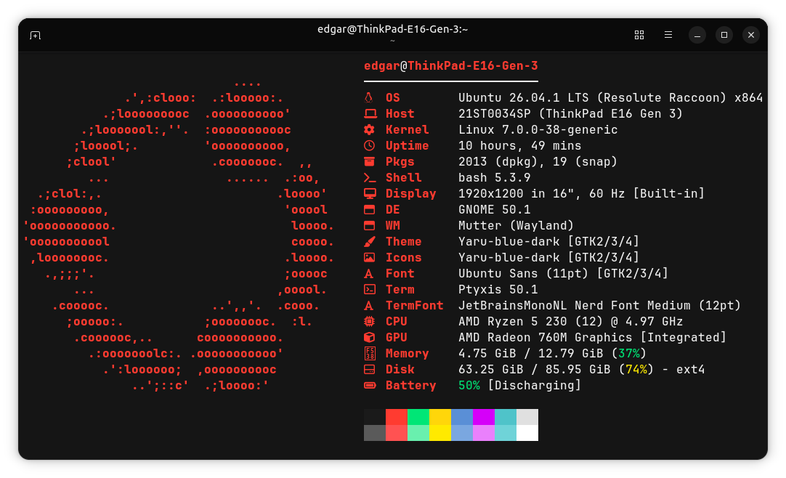

<h1 align="center">Edgar Manuel Gómez García</h1>

  Estudiante de Ingeniería Informática · Universidad de La Laguna (Tenerife, España)

  

---

## 🎓 Sobre mí

Cursando primer año del Grado en Ingeniería Informática. Me interesa entender cómo funcionan las cosas por dentro: depurar errores hasta encontrar su causa real y automatizar el trabajo repetitivo.

  
  <small>Ptyxis + fastfetch en Ubuntu 26.04</small>

## 📦 Proyectos

| Proyecto | Descripción |
|---|---|
| [dotfiles](https://github.com/edgarmgg/dotfiles) | Configuración reproducible de Ubuntu (bash, vim, tmux, tema de terminal) con instalador basado en GNU Stow. |
