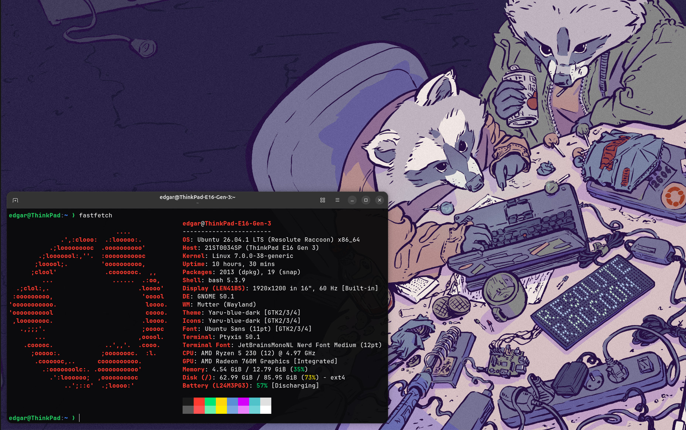

<h1 align="center">Edgar Manuel Gómez García</h1>

  Estudiante de Ingeniería Informática · Universidad de La Laguna (Tenerife, España)

---

## Sobre mí

Cursando primer año del Grado en Ingeniería Informática. Me interesa entender cómo funcionan las cosas por dentro: depurar errores hasta encontrar su causa real y automatizar el trabajo repetitivo.

  
   
  Mi escritorio. Wallpaper: <em>Ask a friend</em>, de osselo.

## Proyectos

| Proyecto | Descripción |
|---|---|
| [dotfiles](https://github.com/edgarmgg/dotfiles) | Configuración reproducible de Ubuntu (bash, vim, tmux, tema de terminal) con instalador basado en GNU Stow. |
